   

# Этерия: Осколок Луны

**Сюжетная RPG для командной строки о лунном осколке, Тени и семи часах до рассвета.** Создайте героя, исследуйте Этерию, решайте, на что потратить время, и определите судьбу города на вершине Шпиля.

[Запуск](#запуск) · [Возможности](#возможности) · [Классы](#классы) · [Маршрут](#маршрут-и-задания) · [Техническая часть](#как-устроен-проект) · [English](#english)

> Основной язык игры — русский. README доступен на русском и английском.

## О проекте

«Этерия: Осколок Луны» — одиночная RPG, реализованная в одном BAT-файле. Игра сочетает выборы в диалогах, загадки, пошаговые бои, управление здоровьем и временем, несколько концовок и анимированные консольные сцены.

| Параметр | Значение |
|---|---|
| Жанр | Сюжетная RPG · исследование · пошаговые бои |
| Платформа | Windows Command Prompt |
| Язык игры | Русский |
| Точка входа | etheria-moonshard.bat |
| Сохранение | savegame.cfg в текущей рабочей папке |
| Требования | Windows cmd.exe и PowerShell; сторонние библиотеки не нужны |

## Завязка

Картограф Орин передаёт герою лунный осколок и просит доставить его на алтарь на вершине Шпиля до рассвета. В Этерии проснулась Тень. Чтобы добраться до финала, предстоит найти ключ от Врат, решить, охотиться ли за Амулетом Света, и узнать, что Хранитель библиотеки знает о слабости противника.

Начальный запас — **20 HP** и **7 часов**. Поездки и некоторые решения расходуют время. Если часы закончатся до финала, город не дождётся рассвета.

## Возможности

- Создание героя с именем и выбором одного из трёх классов.
- Городской хаб с таверной, восточным кварталом, библиотекой, Вратами и отдыхом у фонтана.
- Необязательные задания с несколькими подходами: диалог, загадки, скрытность или бой.
- Пошаговые сражения: атака, защита, особые приёмы, критические удары и отступление там, где оно разрешено.
- Управление ресурсами: отдых восстанавливает до 6 HP и отнимает час; награды могут лечить или уменьшать входящий урон.
- Развилки и **восемь возможных исходов** — от опоздания до победы над Тенью и разных решений судьбы осколка.
- Сохранение и продолжение прохождения.
- Цветной HUD, ASCII-сцены, радужная заставка и реплики с эффектом печати. Нажатие клавиши пропускает задержку.

## Классы

| Класс | Стиль игры | Особенность |
|---|---|---|
| Воин | Сильные атаки и стойкость | Получает на 1 урон меньше |
| Маг | Магические приёмы | Сильный специальный удар |
| Вор | Ловкость и риск | Особая тактика и шанс отступить |

## Маршрут и задания

Исследуйте районы города, разговаривайте с персонажами, собирайте сведения и выбирайте, какие задачи выполнить до рассвета. Необязательные задания помогают получить подсказки, защиту и лечение, но тратят драгоценное время. Несколько решений влияют на доступность финальных вариантов.

## Запуск

1. Скачайте репозиторий или файл etheria-moonshard.bat.
2. Запустите файл в Windows; при необходимости откройте его через Командную строку.
3. Создайте героя и следуйте подсказкам на экране.

Для продолжения выберите соответствующий пункт меню, если savegame.cfg находится в текущей рабочей папке. Не редактируйте сохранение во время игры.

## Управление

Игра управляется вводом пунктов меню и ответов в консоли. Внимательно читайте варианты выбора: некоторые действия расходуют время или запускают бой. Во время текста нажмите любую клавишу, чтобы пропустить анимационную задержку.

## Как устроен проект

Игра собрана в одном пакетном файле. cmd.exe отвечает за сценарий и меню; встроенные вызовы Windows PowerShell используются для отдельных визуальных эффектов и анимаций. Сторонних библиотек и установки зависимостей нет. Прогресс записывается в savegame.cfg.

## Совместимость

Проект рассчитан на Windows и консоль cmd.exe. Цвета, кодировка и кириллица зависят от настроек терминала. Если текст отображается неверно, запустите игру в актуальном Windows Terminal или проверьте кодовую страницу консоли.

## Лицензия

Лицензия не указана. Репозиторий не предоставляет отдельного разрешения на повторное использование или распространение кода.

---

# English

**Etheria: Moonshard is a story-driven command-line RPG about a lunar shard, the Shadow, and seven hours until dawn.** Create a hero, explore the city, manage time, and decide the fate of Etheria.

## Features

- Three character classes and a hub with optional quests.
- Turn-based combat, riddles, dialogue choices, and resource management.
- Seven hours and 20 HP to begin with; choices can consume time.
- Eight possible outcomes, including multiple decisions about the moonshard.
- Save and continue a run, colorful console scenes, and animated text.

## Run

Run etheria-moonshard.bat on Windows using Command Prompt. The game uses built-in PowerShell for console effects and needs no third-party libraries. Progress is stored in savegame.cfg in the current working directory.

No license is declared.
