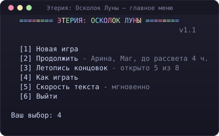
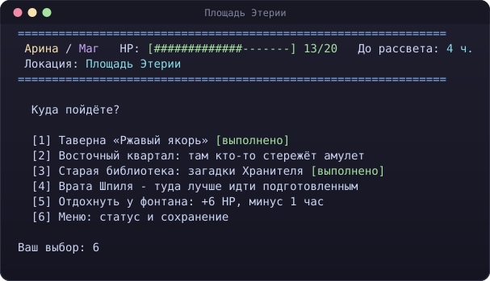
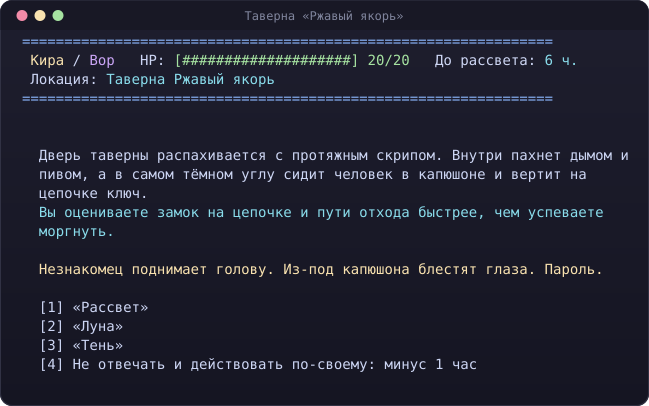
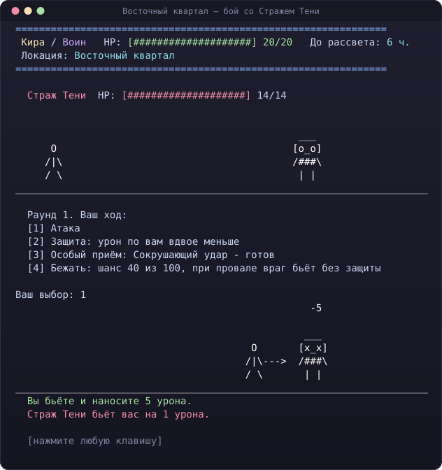
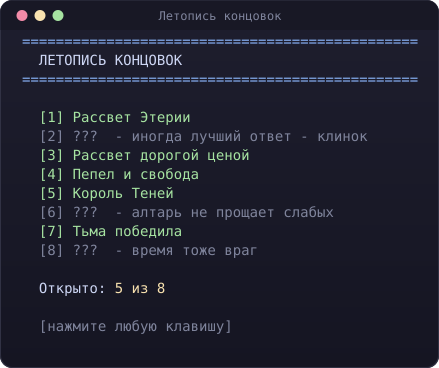
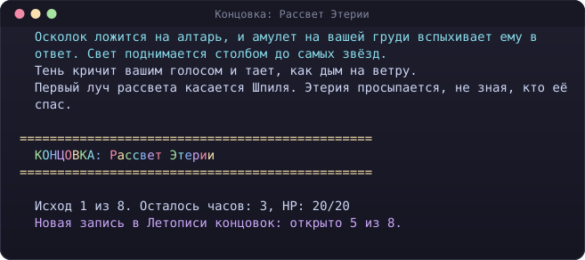
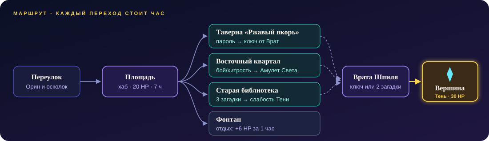
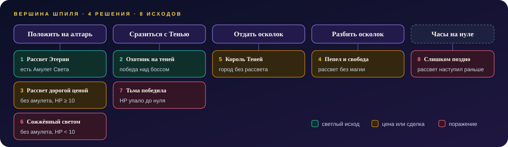
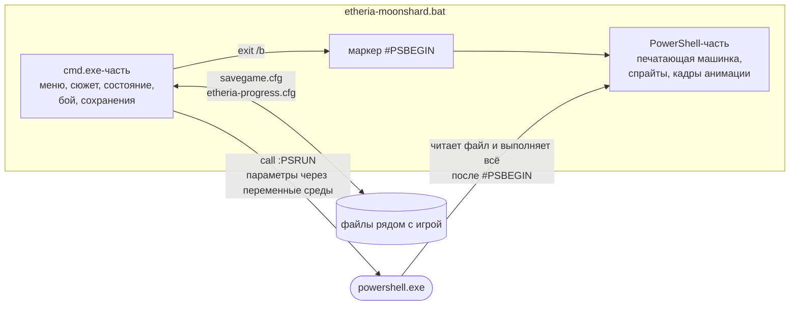

<p align="center"></p>

<p align="center">
  <a href="https://github.com/danilso/etheria-moonshard/actions/workflows/test.yml"></a>
  
  
  
  <a href="LICENSE"></a>
</p>

<h1 align="center">Этерия: Осколок Луны</h1>

<p align="center">
  <b>Сюжетная RPG для командной строки Windows: лунный осколок, проснувшаяся Тень и семь часов до рассвета.</b><br/>
  Один <code>.bat</code>-файл, ноль зависимостей, восемь концовок, анимированные ASCII-бои.
</p>

<p align="center">
  <a href="#быстрый-старт">Быстрый старт</a> ·
  <a href="#скриншоты">Скриншоты</a> ·
  <a href="#игровые-механики">Механики</a> ·
  <a href="#как-это-устроено">Как это устроено</a> ·
  <a href="#тесты">Тесты</a> ·
  <a href="#english">English</a>
</p>

<p align="center"></p>
<p align="center"><sub>Бой с Тенью. Кадры отрисованы ASCII-движком самой игры: <code>tools/Render-Media.ps1</code> берёт спрайты и анимации прямо из <code>etheria-moonshard.bat</code>.</sub></p>

---

## О проекте

Ночью картограф Орин вкладывает вам в ладонь тёплый осколок лунного камня. В Этерии проснулась Тень, и осколок нужно донести до алтаря на вершине Шпиля, пока не взошло солнце. Ключ от Врат ждёт в таверне, Амулет Света охраняет Страж в восточном квартале, а призрачный Хранитель библиотеки знает, куда бить Тень. На всё про всё у вас **20 HP и 7 часов**, и каждый переход стоит часа.

Проект показывает, сколько можно выжать из стандартной консоли Windows без установки чего-либо: сценарий, меню и состояние живут в `cmd.exe`, а печатающая машинка и покадровые ASCII-анимации работают на встроенном Windows PowerShell, который лежит в том же файле.

| | |
|---|---|
| **Жанр** | сюжетная RPG · исследование · пошаговые бои · загадки |
| **Платформа** | Windows 10/11, `cmd.exe` или Windows Terminal |
| **Язык игры** | русский |
| **Размер** | один файл `etheria-moonshard.bat`, около 60 КБ |
| **Зависимости** | нет: только `cmd.exe` и встроенный Windows PowerShell 5.1 |
| **Длительность** | 5–10 минут на прохождение, 8 исходов для коллекции |

## Быстрый старт

1. Скачайте [`etheria-moonshard.bat`](etheria-moonshard.bat) (кнопка **Download raw file**) или весь репозиторий.
2. Дважды щёлкните по файлу. Для лучшей картинки откройте его в Windows Terminal.
3. Введите имя, выберите класс и успейте до рассвета.

```powershell
.\etheria-moonshard.bat
```

Параметры запуска:

| Параметр | Что делает |
|---|---|
| `--instant` | текст появляется сразу, без эффекта печатающей машинки |
| `--no-fx` | упрощённый режим без PowerShell: без анимаций, для старых или урезанных систем |
| `--help` | краткая справка |

> Сохранение `savegame.cfg` и Летопись концовок `etheria-progress.cfg` создаются рядом с игрой. Если игра лежит в папке только для чтения, скопируйте её, например, на рабочий стол.

## Скриншоты

<table>
  <tr>
    <td width="50%"><p align="center"><sub>Главное меню: продолжение, Летопись концовок, скорость текста</sub></p></td>
    <td width="50%"><p align="center"><sub>Площадь: HUD с HP и часами, выполненные задания</sub></p></td>
  </tr>
  <tr>
    <td><p align="center"><sub>Таверна: реплики зависят от класса, неверный пароль ранит</sub></p></td>
    <td><p align="center"><sub>Пошаговый бой: ASCII-сцена, полоса HP врага, журнал раунда</sub></p></td>
  </tr>
  <tr>
    <td><p align="center"><sub>Летопись: открытые концовки и намёки на остальные</sub></p></td>
    <td><p align="center"><sub>Финал: радужный заголовок и запись в Летопись</sub></p></td>
  </tr>
</table>

<sub>Все скриншоты сгенерированы из настоящего вывода игры скриптом <a href="tools/Render-Media.ps1"><code>tools/Render-Media.ps1</code></a>, а не нарисованы вручную.</sub>

## Возможности

- **Три класса** со своей механикой боя, репликами и способами решать задания.
- **Город-хаб** с тремя необязательными заданиями. Каждое можно пройти несколькими путями: словом, силой, хитростью или особым навыком класса.
- **Время как ресурс.** Переходы, отдых и некоторые решения отнимают часы. Опоздать можно на любом шаге.
- **Пошаговые бои**: атака, защита, особый приём с перезарядкой, критические удары, оглушение, побег. Анимации разыгрываются покадрово.
- **Восемь загадок** в случайном порядке без повторов у Хранителя и у Врат.
- **Восемь концовок** и **Летопись**, которая запоминает открытые исходы между запусками и даёт намёки на остальные.
- **Сохранение и продолжение** с проверкой файла: повреждённое или отредактированное сохранение не сломает игру.
- **Настраиваемая скорость текста**; любая клавиша дописывает реплику мгновенно.
- **Резервный режим** без PowerShell: игра остаётся проходимой даже без анимаций.

## Игровые механики

<p align="center"></p>

### Классы

| Класс | Атака | Особый приём (раз в 3 хода) | Побег | Особенность |
|---|---|---|---|---|
| **Воин** | 3–5 | Сокрушающий удар: 6–9 | 40% | получает на 1 урон меньше |
| **Маг** | 2–4 | Огненный шар: 6–8 | 50% | читает мысли и изгоняет Стража светом |
| **Вор** | 2–5, крит ×2 с шансом 30% | Удар в спину: 5–6 и оглушение | 75% | бесшумно крадёт амулет |

### Задания и награды

| Место | Задача | Награда |
|---|---|---|
| Таверна «Ржавый якорь» | назвать пароль Орина или добыть ключ по-своему | ключ от Врат: без него придётся отвечать на две загадки |
| Восточный квартал | победить, обойти или отвлечь Стража Тени (14 HP) | Амулет Света: −1 к входящему урону и путь к лучшему финалу |
| Старая библиотека | ответить хотя бы на две загадки из трёх | слабость Тени: +2 урона по боссу; за 3 из 3 ещё +4 HP |
| Фонтан | отдохнуть | +6 HP за 1 час; при полном здоровье время не тратится |

### Бой

| Противник | HP | Урон | Особенность |
|---|---|---|---|
| Страж Тени | 14 | 2–3 | от него можно сбежать |
| Тень | 30 | 3–5 | каждый 4-й раунд бьёт на +3, бежать некуда |

Защита вдвое снижает входящий урон и ускоряет перезарядку приёма. Бонусы складываются: Воин с Амулетом Света получает на 2 урона меньше.

<details>
<summary><b>Карта концовок (спойлеры)</b></summary>
<br/>
<p align="center"></p>
</details>

## Как это устроено

Игра — полиглот: один файл одновременно является пакетным сценарием и PowerShell-скриптом.



- **Состояние** хранится в переменных `cmd` с отложенным раскрытием (`!var!`), выбор делается через `choice`, переходы — через `goto`/`call`.
- **Цвета** — ANSI-последовательности; символ ESC получается трюком `prompt $E`.
- **PowerShell-часть** запускается командой `call :PSRUN`: `powershell.exe` читает тот же файл, отрезает всё после маркера `#PSBEGIN` и выполняет. Параметры (`ps_mode`, текст реплики, урон, позы) передаются через переменные среды, поэтому временные файлы не нужны.
- **Анимации** — кадры из спрайтов, которые «штампуются» в буфер 70×7 и перерисовываются на месте через `ESC[nA`. Печатающая машинка переносит строки по словам и останавливается по любой клавише.
- **Без PowerShell** (`--no-fx` или если `powershell.exe` не найден) текст выводится обычным `echo`, а сцены пропускаются.

### Структура репозитория

```text
etheria-moonshard/
├── etheria-moonshard.bat      # игра целиком: cmd-сценарий + PowerShell-движок
├── assets/
│   └── etheria-banner.svg     # анимированный баннер
├── docs/media/                # скриншоты, анимация боя, схемы
├── tests/
│   └── Test-Game.ps1          # статические проверки и прогон всех концовок
├── tools/
│   └── Render-Media.ps1       # генерация скриншотов из вывода игры
├── .github/workflows/test.yml # CI на windows-latest
├── CHANGELOG.md
└── LICENSE
```

## Тесты

У игры есть режим автотестов: при `ETHERIA_TEST=1` она не меняет кодовую страницу, не ждёт, отключает эффекты и завершается сразу после финала. Тест подаёт на вход заранее записанные нажатия и проверяет, какая концовка получилась.

```powershell
powershell -ExecutionPolicy Bypass -File tests\Test-Game.ps1
```

Что проверяется:

- файл в UTF-8 без BOM и с окончаниями строк CRLF, иначе `cmd.exe` споткнётся;
- у каждого `goto` и `call` есть метка, метки не повторяются;
- PowerShell-блок разбирается без синтаксических ошибок;
- **все 8 концовок** достижимы, сохранение переживает перезапуск, исход записывается в Летопись.

Тесты запускаются в GitHub Actions на `windows-latest` при каждом push и pull request.

Скриншоты пересобираются одной командой:

```powershell
powershell -ExecutionPolicy Bypass -File tools\Render-Media.ps1
```

## Совместимость и решение проблем

| Симптом | Что сделать |
|---|---|
| Окно сразу закрывается | файл пересохранён с переводами строк LF (редактор, копирование текстом). Скачайте заново кнопкой **Download raw file** или через ZIP |
| Вместо кириллицы «кракозябры» | запустите в Windows Terminal или выберите в консоли шрифт с кириллицей (Consolas, Cascadia Mono) |
| Видны коды вида `←[93m` | старая консоль без ANSI: используйте Windows 10/11 или Windows Terminal |
| PowerShell запрещён политикой | запустите с `--no-fx`: игра пройдётся без анимаций |
| Анимации подтормаживают | выберите «мгновенно» в пункте «Скорость текста» или запустите с `--instant` |
| «Не удалось записать сохранение» | переместите игру в папку с правом записи |

## История изменений

Что нового в версии 1.1: Летопись концовок, экран «Как играть», настройка скорости текста, параметры запуска, проверка сохранений, резервный режим без PowerShell, автотесты и CI. Подробности — в [CHANGELOG.md](CHANGELOG.md).

## Лицензия

[MIT](LICENSE) © Daniil ([@danilso](https://github.com/danilso))

---

## English

<p align="center"></p>

**Etheria: Moonshard** is a story-driven RPG for the Windows command line. The cartographer Orin hands you a warm shard of moonstone: carry it to the altar atop the Spire before dawn, while the awakened Shadow hunts you. You start with **20 HP and 7 hours**, and every trip across the city costs an hour.

- **One file, no dependencies.** `etheria-moonshard.bat` is a batch/PowerShell polyglot: `cmd.exe` drives the story, menus and state, and the built-in Windows PowerShell 5.1 renders the typewriter text and frame-by-frame ASCII battles.
- **Three classes** (Warrior, Mage, Thief), each with its own stats, special move and dialogue.
- **Three optional quests** with several approaches, eight shuffled riddles and turn-based combat with crits, stuns, blocking and fleeing.
- **Eight endings** and a persistent **Chronicle** that records the endings you've found and hints at the rest.
- **Save/continue** with validation, adjustable text speed, a `--no-fx` fallback mode, and `--instant` text.
- **Automated tests**: static checks of the script plus scripted playthroughs that reach all 8 endings, run on GitHub Actions (`windows-latest`).
- Screenshots in this README are generated from the game's real output by `tools/Render-Media.ps1`.

**Run:** download `etheria-moonshard.bat` and double-click it, ideally in Windows Terminal. The game text is in Russian.

**License:** [MIT](LICENSE).
